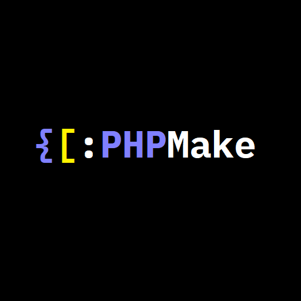

# [PHPMake](https://github.com/phpmake/phpmake/)

A PHP build automation tool using JSON configuration file.

[](https://packagist.org/packages/phpmake/phpmake) [](https://github.com/phpmake/phpmake/actions/workflows/default.yml) [](https://github.com/phpmake/phpmake/actions/workflows/github-code-scanning/codeql)
[](https://php.net/) [](https://github.com/phpmake/phpmake/issues)  [](LICENSE) [](documents/CONTRIBUTING.txt)



## Contents

* [Overview](#overview)
* [Features](#features)
* [Requirements](#requirements)
* [Installation](#installation)
* [Usage](#usage)
* [FAQ](#faq)
* [Support](#support)
* [Changelog](#changelog)
* [ToDo](#todo)
* [Contributing](#contributing)
* [Code of Conduct](#code-of-conduct)
* [DCO](#dco)
* [Contributors](#contributors)
* [Notice](#notice)
* [License](#license)

## Overview

A lightweight PHP build automation tool inspired by GNU Make and Apache Ant, using JSON configuration files. It supports common tasks like file operations, command execution, and dependency management with cross-platform compatibility. (Windows/Linux/macOS)

PHPMake provides a modular task architecture, dependency-aware targets, filesystem safeguards, and a command-line interface for repeatable build workflows.

## Features

* No third-party PHP package dependencies at runtime; Composer is used for installation and PHP extensions are required.
* Define build processes in human-readable JSON
* Specify execution order with dependencies
* Works on Microsoft Windows, GNU+Linux, and Apple macOS
* Built-in tasks:
  * `create_directory` (create directories)
  * `delete` (remove files/directories)
  * `copy` (file/directory copying)
  * `exec` (execute processes without a shell)
  * `echo` (output messages)
  * `archive` (archive/compress a file or directory)
* Filesystem tasks are restricted to paths inside the project directory (CWD)
* Logging options:
  * `-d`/`--debug` for detailed logs
  * `-nl`/`--no-log` to disable file logging
  * `-s`/`--silent` to suppress normal console output (errors remain visible on STDERR)
* `-vb`/`--validate-build` to check configuration syntax
* `--diagnostics` to show environment info
* `--init` to create a sample `build.json`
* CI/CD pipeline integration
* PHP 8.3+ (active)

## Requirements

1. PHP >= 8.3
2. Composer >= 2
3. PHP extensions: `ctype`, `json`, and `zip`

### Versions

| Package version | Branch        | PHP version | Status         |
|-----------------|---------------|-------------|----------------|
| dev-main        | `main`        | 8.3         | Active         |
| 2.*             | `main`        | 8.3         | Active         |

* **Active**: Full support
* **Maintenance**: Bug/Security fixes only
* **EOL**: Unsupported

## Installation

By [Composer](https://getcomposer.org/) project-specific installation:

```shell
composer require --dev phpmake/phpmake
```

By [Composer](https://getcomposer.org/) global installation:

```shell
composer global require phpmake/phpmake
```

## Usage

1. **Create a `build.json` file** (or generate a sample):

    ```sh
    php vendor/bin/phpmake --init
    ```

    Example configuration:

    ```json
    {
        "name": "MyProject",
        "description": "Sample project build configuration",
        "version": "2.0.2",
        "targets": {
            "clean": {
                "tasks": [{ "type": "delete", "params": { "path": "build" } }]
            },
            "build": {
                "depends": ["clean"],
                "tasks": [
                    { "type": "create_directory", "params": { "name": "build" } },
                    { "type": "copy", "params": { "source": "src/", "dest": "build/" } },
                    { "type": "echo", "params": { "message": "Replace this step with your project's compiler command." } }
                ]
            }
        },
        "default_target": "build"
    }
    ```

2. **Run the builder**:

For GNU+Linux:

```sh
chmod +x bin/phpmake.php
```

Then

```sh
vendor/bin/phpmake
```

Or

```sh
php vendor/bin/phpmake
```

Or

```sh
# Validate configuration.
php vendor/bin/phpmake --validate-build

# Run default target with debug logging.
php vendor/bin/phpmake --debug
```

Or

```sh
# Run test target silently.
php vendor/bin/phpmake test --silent
```

### QA/QC test

Run tests to ensure everything works as expected:

```shell
composer test
```

Or

```shell
vendor/bin/phpunit tests/
```

### Commands

| Command                      | Description                      |
| ---------------------------- | -------------------------------- |
| `phpmake`                    | Run default target               |
| `phpmake <target>`           | Run specific target              |
| `phpmake --help` / `-h`      | Show help menu                   |
| `phpmake --version` / `-v`   | Show PHPMake version             |
| `phpmake --validate-build` / `-vb` | Validate build file        |
| `phpmake --diagnostics`      | Show system information          |
| `phpmake -d` / `--debug`     | Enable debug/verbose logging     |
| `phpmake -nl` / `--no-log`   | Disable file logging             |
| `phpmake -s` / `--silent`    | Suppress normal output; errors remain visible on STDERR |
| `phpmake --init`             | Create sample build.json file    |

### Supported tasks

| Task type          | Parameters                                   | Description            |
| ------------------ | -------------------------------------------- | ---------------------- |
| `create_directory` | `name` (string)                              | Create directory       |
| `delete`           | `path` (string)                              | Delete file/directory  |
| `copy`             | `source` (string), `dest` (string)           | Copy files/directories |
| `exec`             | `command` (string), optional `args` (scalar array), `timeout` (seconds, 0<timeout<=86400) | Execute a process without a shell |
| `echo`             | `message` (string)                           | Output message         |
| `archive`          | `source` (string), `output` (string)         | Archive a file/directory to ZIP |

`exec` passes an argument vector directly to the process (no shell expansion or pipelines). Its default timeout is 300 seconds (maximum 86400); each output stream is capped at 1 MiB. On timeout or output overflow, PHPMake terminates the process tree using Windows `taskkill /T` or a POSIX process group when the POSIX extension is available; otherwise it falls back to terminating the direct process. Filesystem task paths are normalized and must resolve inside the project working directory. Symlink/junction ancestors that escape the project are rejected. Destructive tasks reject the project root; `..` is permitted only when the normalized result remains inside CWD.

### Example build file

See [build.json.example](build.json.example) file.

## FAQ

See [FAQ.txt](documents/FAQ.txt) file.

## Support

For questions, bug reports, and feature requests, [open an issue](https://github.com/phpmake/phpmake/issues).

## Changelog

See [CHANGELOG.txt](documents/CHANGELOG.txt) file.

## ToDo

See [TODO.txt](documents/TODO.txt) file.

## Contributing

Contributions are welcome! Please follow these steps:

1. Fork repository.
2. Create a new branch for your feature or bugfix.
3. Submit a pull request with a detailed description of your changes.

For more details see [CONTRIBUTING.txt](documents/CONTRIBUTING.txt).

## Code of Conduct

See [CODE_OF_CONDUCT.txt](documents/CODE_OF_CONDUCT.txt) file.

## DCO

See [DCO.txt](documents/DCO.txt) file.

## Contributors

See [CONTRIBUTORS.txt](documents/CONTRIBUTORS.txt) file.

## Notice

See [NOTICE.txt](documents/NOTICE.txt) file.

## License

This open-source software is distributed under the GPL-3.0 license. See [LICENSE](LICENSE) file.
